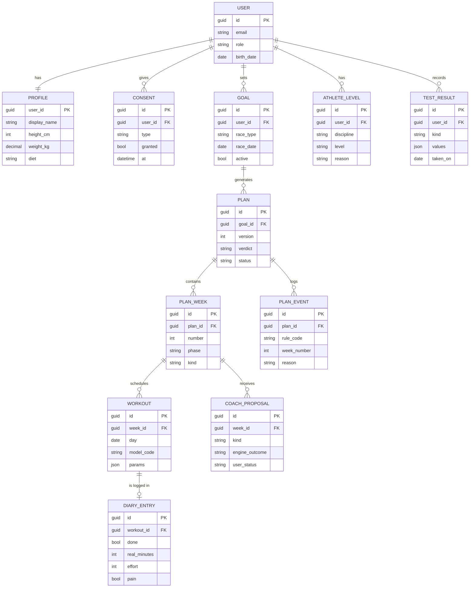

# Gym Me Coach — Schema dei dati

> Approvato il 19/10/2026 (task `F1-T08`). Il dettaglio dei campi è nel foglio `BE · Models` del
> tracker; si crea in codice (EF Core + PostgreSQL) in F2.

## Come si legge

Ogni riquadro è una tabella del database; ogni linea dice a chi appartiene. Un utente ha un solo
profilo ma può avere molti consensi, obiettivi, livelli e test. Un obiettivo genera uno o più
piani, un piano contiene le settimane, una settimana contiene le sedute, e ogni seduta può avere
una voce del diario. Nomi in inglese (`D5`).

Il diagramma mostra i campi principali; l'elenco completo è nel tracker.

## Scelte di progetto

1. **Dati di riferimento nel motore, non nel database.** Livelli, gare, modelli di seduta e regole
   restano nel codice del `PlanEngine`; il database li richiama per codice (`NUO-01`, `N3`). Il
   motore resta una libreria senza database.
2. **Questionario di salute: si salva solo l'esito.** Per `SIC-02` si conservano «idoneo» e «via
   libera del medico» nei consensi, non le singole risposte.
3. **Piani con versioni.** Se il piano si rigenera, il vecchio resta archiviato (servono ai grafici
   dei progressi). Ogni piano conserva uno `InputSnapshot` con le risposte usate, così
   «stesse risposte → stesso piano» resta verificabile.
4. **Parametri delle sedute e valori dei test come JSON** (`jsonb` in PostgreSQL).
5. **`PLAN_EVENT`** registra quale regola (`ADA-01`…) ha cambiato il piano e perché.
6. **Cancellazione a cascata**: se l'utente cancella l'account spariscono tutti i suoi dati.
7. **Più avanti**: la lista della spesa (`SHOPPING_ITEM`) si aggiunge in F6.
